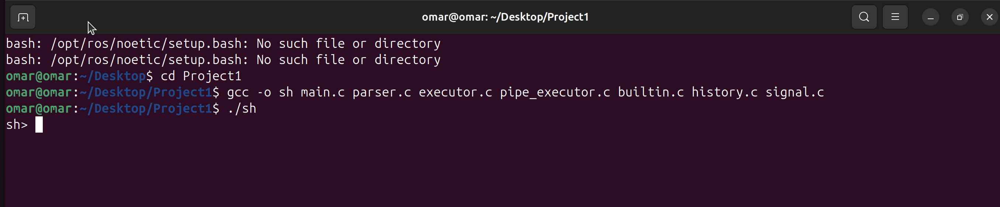
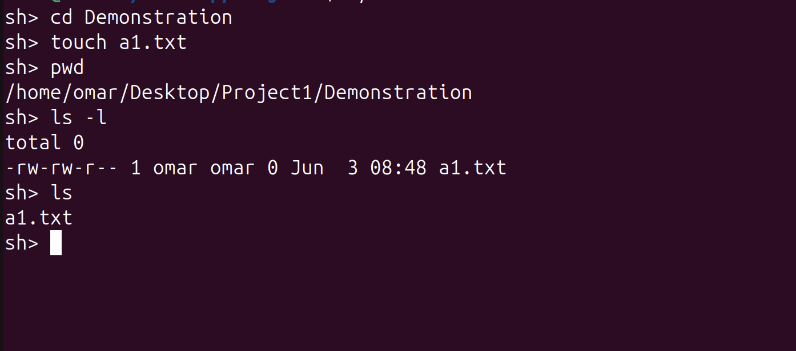
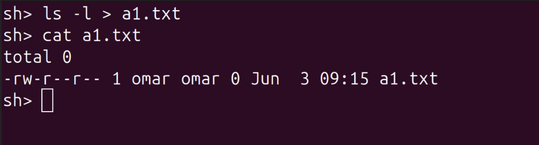
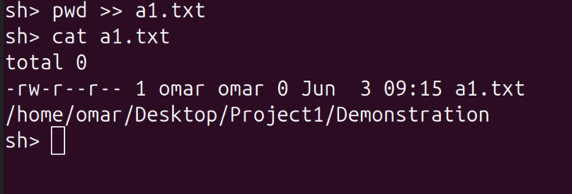
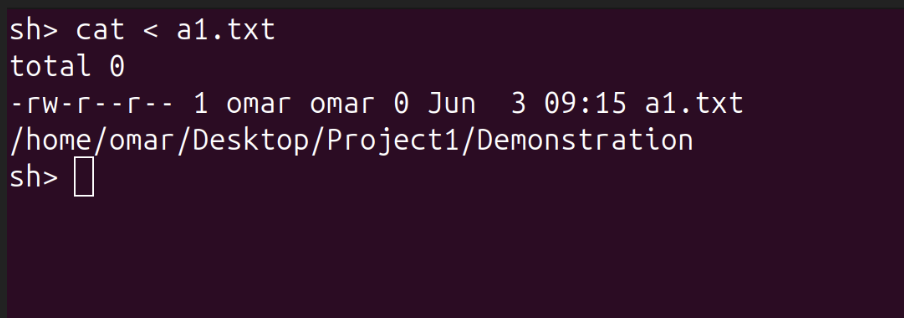
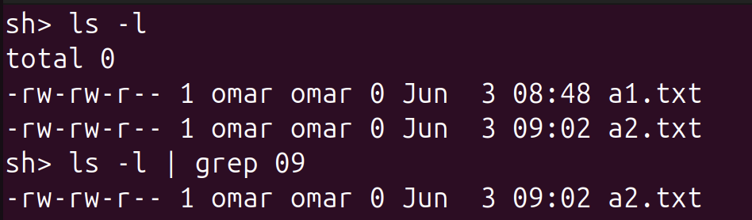
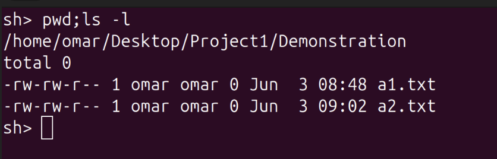
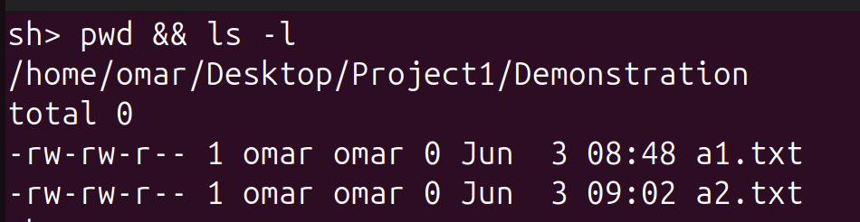
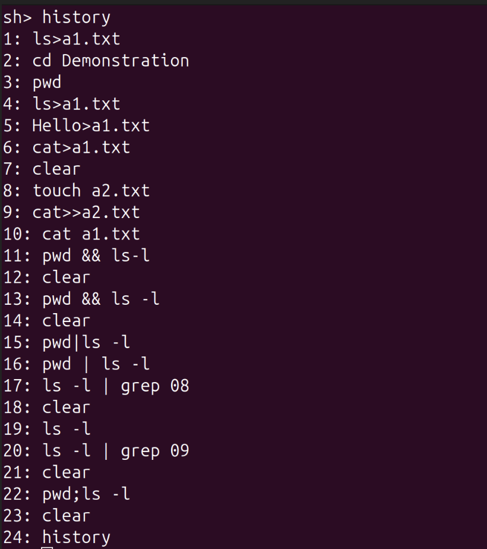

# Unix Shell in C

A simple Unix shell written in C. It runs system commands and supports I/O
redirection, pipelines of any length, command chaining with `;` and `&&`,
command history, and Ctrl+C handling. Built with POSIX system calls: `fork`,
`execvp`, `waitpid`, `pipe`, `dup2`, and `sigaction`.

Made for CSE321 (Operating Systems) at BRAC University.



## Features

| Feature | Example | How it works |
|---------|---------|--------------|
| Command prompt | `sh>` | Reads a line of input in a loop with `fgets` |
| System commands | `pwd`, `ls -l`, `touch a1.txt` | `fork()` a child process, then `execvp()` the command while the parent waits with `waitpid()` |
| Output redirection | `ls -l > a1.txt` | Opens the file with `O_TRUNC` and uses `dup2()` to point stdout at it |
| Append redirection | `pwd >> a1.txt` | Same as above, but opens the file with `O_APPEND` |
| Input redirection | `cat < a1.txt` | Uses `dup2()` to point stdin at the file |
| Piping | `ls -l \| grep 09` | Creates one `pipe()` per connection and wires each command's stdout to the next command's stdin |
| Multiple commands with `;` | `pwd; ls -l` | Runs each command in order |
| Command sequence with `&&` | `pwd && ls -l` | Runs the next command only if the previous one succeeded (exit status 0) |
| History | `history` | Stores the last 100 commands and lists them with numbers |
| Signal handling | Ctrl+C | A `SIGINT` handler set with `sigaction()` keeps the shell running, while the running command (which gets the default handler after `exec`) is terminated |
| Built-in commands | `cd`, `exit`, `history` | Handled inside the shell process instead of forking |

## Project structure

| File | Responsibility |
|------|----------------|
| [`src/main.c`](src/main.c) | Main loop: shows the prompt, saves history, and splits input on `;` and `&&` |
| [`src/parser.c`](src/parser.c) | Splits a command into arguments, and a pipeline into separate commands |
| [`src/executor.c`](src/executor.c) | Runs a single command with `fork`/`execvp` and handles `<`, `>`, and `>>` |
| [`src/pipe_executor.c`](src/pipe_executor.c) | Runs pipelines such as `cmd1 \| cmd2 \| cmd3` |
| [`src/builtin.c`](src/builtin.c) | Built-in commands: `cd`, `exit`, and `history` |
| [`src/history.c`](src/history.c) | Stores and prints command history |
| [`src/signal.c`](src/signal.c) | Sets up the Ctrl+C (`SIGINT`) handler |

Each `.c` file has a matching `.h` header.

## How to run

Requires a Unix-like system (Linux or macOS) with `gcc`. Developed and tested on Ubuntu.

```bash
make
./sh
```

Or compile without `make`:

```bash
gcc -o sh src/*.c
./sh
```

Type `exit` to quit the shell.

## Screenshots

**System commands**



**Output redirection (`>`)**



**Append redirection (`>>`)**



**Input redirection (`<`)**



**Piping (`|`)**



**Multiple commands with `;`**



**Command sequence with `&&`**



**History**



## Limitations

- Quoted arguments (for example `echo "hello world"`) are not supported. Arguments are split on spaces.
- Built-in commands (`cd`, `history`, `exit`) can't be used inside a pipeline.
- A pipeline can have up to 10 commands.

## Project specification

The original task is in [docs/project_specification.pdf](docs/project_specification.pdf).
